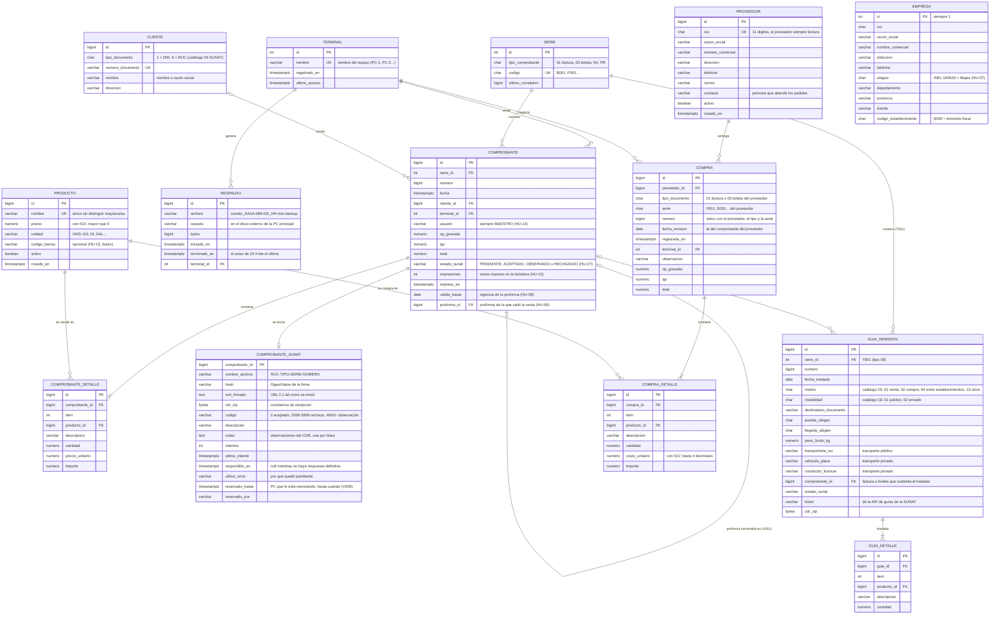

# Modelo de datos (T-01)

Base de datos central PostgreSQL 16 en la PC principal. Todas las terminales
leen y escriben sobre ella; por eso los correlativos se generan en la base de
datos y no en cada PC (HU-16).

## Diagrama entidad-relación



`EMPRESA` no se relaciona con las demás tablas: guarda los datos de la
ferretería que se imprimen en la cabecera de cada ticket (migración V005).
`PROVEEDOR` (migración V006, HU-04) se relaciona con `COMPRA` desde la
migración V012 (HU-11).

## Decisiones

| Decisión | Motivo |
|---|---|
| Los precios se guardan **con IGV incluido**. | Es como la ferretería fija y anuncia sus precios; la operación gravada y el IGV se calculan al vender. |
| Sin columnas de stock en `producto`. | HU-01 lo excluye expresamente (sin control de inventario). |
| `serie.ultimo_correlativo` se incrementa con `UPDATE ... RETURNING`. | La fila queda bloqueada hasta el fin de la transacción: dos terminales no pueden obtener el mismo número (T-05). |
| `(serie_id, numero)` es único en `comprobante`. | Segunda barrera contra correlativos repetidos. |
| `comprobante_detalle.descripcion` y `precio_unitario` se copian del producto. | Si el producto cambia de precio, el comprobante emitido no cambia. |
| `terminal` guarda el nombre del equipo. | Cada documento registra desde qué PC se emitió (criterio de HU-14). |
| `usuario` es texto fijo `MAESTRO`. | Perfil único sin credenciales (RF-14). |
| `cliente` es único por `(tipo_documento, numero_documento)`. | Un DNI o RUC se registra una sola vez aunque dos PC lo intenten a la vez (HU-03). |
| `comprobante` exige `op_gravada + igv = total`. | Un error de cálculo no puede llegar a un comprobante emitido (HU-05). |
| `comprobante.impresiones` empieza en 0. | Si la ticketera falla, el comprobante queda registrado y se sabe que falta imprimirlo (HU-12). |
| `proveedor` es único por `ruc` y lo exige con su prefijo (10, 15, 16, 17 o 20). | El proveedor emite facturas, así que siempre tiene RUC; dos PC no pueden registrarlo dos veces (HU-04). |
| El XML firmado y el CDR se guardan en `comprobante_sunat`, aparte de `comprobante`. | Pesan varios KB: el historial y la emisión no los leen; se conservan para auditoría (HU-07). |
| Un estado SUNAT definitivo (aceptado, observado o rechazado) ya no cambia. | Si dos PC reenvían el mismo comprobante, la segunda respuesta no pisa la primera (V007). |
| Una factura (serie de tipo `01`) solo se guarda con un cliente de RUC (trigger `ck_factura_con_ruc`, V008). | La SUNAT rechaza la factura sin RUC; la base central lo impide aunque una PC tenga una versión vieja del programa (HU-06). |
| Cada PC aparta los pendientes antes de reenviarlos (`comprobante_sunat.reservado_hasta`, V009) con `FOR UPDATE SKIP LOCKED`. | Si dos PC tienen la SUNAT configurada, un comprobante no se envía dos veces a la vez; si la PC se apaga, la reserva vence a los 5 minutos y otra lo retoma (HU-17). |
| Índice parcial de comprobantes `PENDIENTE`. | El reenvío automático (HU-17) los encuentra rápido entre miles de aceptados. |
| La proforma vive en `comprobante` (serie `PR01`) con su `valida_hasta`; la venta que sale de ella guarda `proforma_id` (V011). | La conversión copia el detalle sin reescribirlo y el historial muestra en qué boleta o factura terminó cada proforma (HU-09). |
| `proforma_id` es único (índice parcial `ux_comprobante_proforma`) y el trigger `ck_proforma` solo deja convertir una proforma vigente. | Si dos PC convierten la misma proforma a la vez, una sola emite; la otra recibe el aviso y no gasta número (HU-09). |
| `compra` es única por `(proveedor_id, tipo_documento, serie, numero)` (V012). | El mismo comprobante del proveedor no se registra dos veces aunque dos PC lo intenten a la vez; el mismo número de otro proveedor sí (HU-11). |
| `compra_detalle.costo_unitario` admite 4 decimales. | Algunos productos se compran por millar o por caja y su costo unitario tiene más de dos decimales; el importe sí va a céntimos. |
| La guía de remisión tiene su tabla `guia_remision` con la respuesta de la SUNAT en la misma fila (V013). | La guía no tiene importes ni va en el total de ventas; se envía por la API REST de guías, que responde con un ticket y luego el CDR (HU-10). |
| `ck_guia_transporte` exige el RUC del transportista (público) o la placa, el DNI y la licencia del conductor (privado). | La SUNAT rechaza la guía sin esos datos; la base central no la deja guardar aunque una PC tenga una versión vieja (HU-10). |
| `respaldo` guarda dónde quedó cada respaldo, no el archivo (V010). | El archivo vive en el disco externo; la base solo necesita saber cuándo fue el último para el aviso de las 24 horas en las tres PC (HU-15). |
| `empresa` tiene una sola fila (`id = 1`). | Las tres PC imprimen la misma cabecera; se corrige con un `UPDATE`, sin recompilar. |

## Datos de la empresa

La migración V005 deja valores provisionales. Antes del piloto se reemplazan
por los de la ficha RUC del local, desde `psql` en la PC principal:

```sql
UPDATE empresa
SET ruc = '20XXXXXXXXX', razon_social = '...', direccion = '...', telefono = '...'
WHERE id = 1;
```

La migración V007 agrega el domicilio fiscal que va en el XML de la SUNAT
(ubigeo 040520, Majes, Caylloma, Arequipa, establecimiento 0000). Si la ficha
RUC dice otra cosa:

```sql
UPDATE empresa
SET ubigeo = '040520', departamento = 'AREQUIPA', provincia = 'CAYLLOMA',
    distrito = 'MAJES', codigo_establecimiento = '0000'
WHERE id = 1;
```

Las clases de `src/Condor.Dominio` reflejan estas tablas. Las sentencias SQL
están en `db/migraciones` (T-03).
